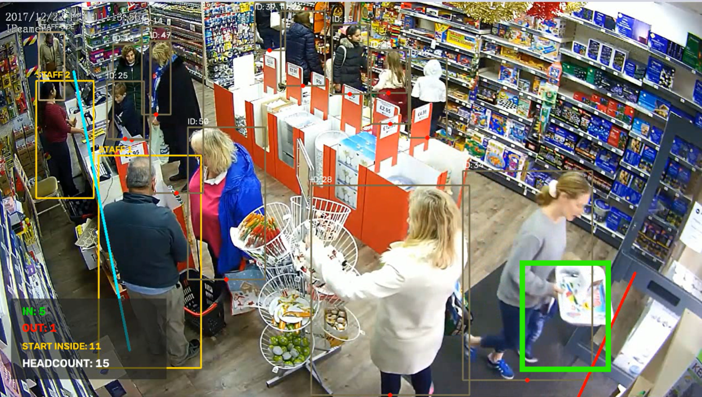

# People Counter

Detect and track people crossing a configured line in a video. The program writes an annotated video and a CSV containing one row per accepted event.

## Project layout

```text
tracker/
├── input/
│   ├── .gitkeep
│   └── cctv_video.mp4                      # input video, committed normally
├── models/
│   ├── .gitkeep
│   ├── osnet_ain_x1_0_msmt17.pth           # ReID weights, committed normally
│   └── yolov8x.pt                          # YOLO weights, stored with Git LFS
├── documentation/
│   ├── PROJECT_NOTE.pdf                    # overview and observed limitations
│   ├── TRACKING_HANDLING_NOTE.pdf          # occlusion, groups, re-entry, staff
│   └── tracking_failure_example.png        # example tracking failure
├── outputs/
│   └── .gitkeep                            # keeps the empty folder in Git
├── test.py
├── requirements.txt
├── .gitignore
├── .gitattributes
└── README.md
```

The sample input video and OSNet weights are included in the repository as normal files. The YOLO weights file exceeds GitHub's 100 MB per-file limit, so it is stored with Git LFS. Git LFS storage and bandwidth quotas apply. The model files are third-party assets; check their applicable license terms before redistributing them publicly.

## Setup on Windows

Use Python 3.12. In PowerShell, from the project folder:

```powershell
py -3.12 -m venv .venv
.\.venv\Scripts\Activate.ps1
python -m pip install --upgrade pip
```

Install PyTorch using the command recommended by the [official PyTorch installation selector](https://pytorch.org/get-started/locally/) for your system, then install the remaining dependencies:

```powershell
python -m pip install -r requirements.txt
```

## Run

From the project folder, with the virtual environment active:

```powershell
python test.py
```

The script uses CUDA when available and otherwise runs on the CPU. CPU processing can take significantly longer. Adjust `line_start` and `line_end` in `test.py` to match your camera view.

## Output

Each run saves these files in `outputs/`:

- `output_boundary_exclusion.mp4` — annotated video
- `output_boundary_exclusion.csv` — event log with `timestamp`, `person_id`, `event` (`IN`/`OUT`), and `headcount` columns

## Project note

The [one-page project note](documentation/PROJECT_NOTE.pdf) summarizes the approach, the missed OUT event and inconsistent IDs, and possible improvements. The example frame is also shown here:



The [tracking and counting note](documentation/TRACKING_HANDLING_NOTE.pdf) explains how the implementation handles occlusion, groups entering together, re-entry, and staff-versus-customer classification, including the limits of each approach.

## Upload to GitHub

1. Make sure `https://github.com/mugilansGIT/people-counter-tracking` exists and is empty (do not initialize it with a README, license, or `.gitignore`; those files already exist here).
2. In PowerShell, from this project folder, install Git LFS and stage the project:

```powershell
git lfs install
git add .gitattributes
git add -A
git lfs ls-files
git status
```

Confirm `models/yolov8x.pt` appears in the LFS file list, and check that `.venv` and generated output files are not staged. The checked-in `.gitattributes` configures the YOLO weights for LFS.

3. Commit the files, connect this local repository to GitHub, and push the `main` branch:

```powershell
git commit -m "Add people counter project"
git remote add origin https://github.com/mugilansGIT/people-counter-tracking.git
git push -u origin main
```

The `.gitignore` excludes `.venv` and generated files in `outputs/`.

## Clone from GitHub

Install Git LFS, then clone the repository. Git LFS downloads the YOLO weights during cloning:

```powershell
git lfs install
git clone <repository-url>
```

After cloning, install the Python dependencies and follow the [Run](#run) steps. The input video and both model files should already be present in `input/` and `models/`.
